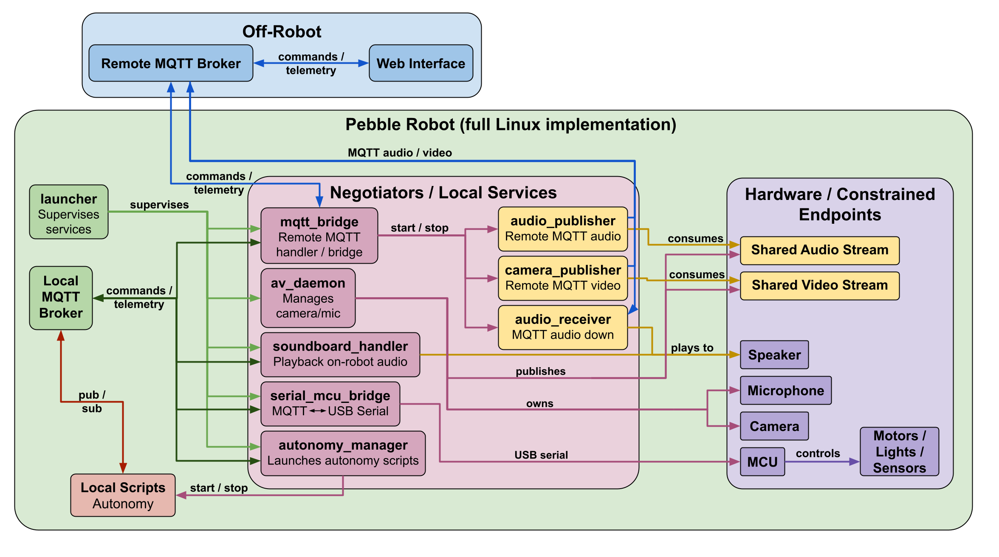

# Pebble

Pebble is a local-first MQTT communication stack for distributed components.

Robots at minimum have to implement the MQTT standard contract, but may be more complicated. Below is an example of a full-Linux architecture, the one present on Goob.



## Included Reference Platforms

These platform directories are preserved as repository examples:
- Goob
- Fred
- MiniLAMP (Seeed XIAO ESP32-C6 firmware)
- BUMPERBOT

## Repository Layout

- `control/` - local runtime services (`launcher`, `av_daemon`, `mqtt_bridge`, `ros1_bridge`, `serial_mcu_bridge`, `soundboard_handler`, `autonomy_manager`) plus service-specific support files such as `control/services/serial_standard.md`
- `modules/` - versioned robot-owned control contracts and reusable UI/input modules; see [module controls](modules/README.md)
- `robots/` - robot-local module definitions and composition examples
- `web-interface/` - module gateway, compatibility UI, and web runtime files
- `autonomy/apriltag-follow/` - AprilTag/autonomy utilities
- `audio/` - MQTT audio publisher/receiver scripts
- `video/` - MQTT video publisher scripts
- `soundboard/` - soundboard MQTT contract and usage docs
- `firmware/` - MCU firmware
- `mqtt_standard.md` - topic and payload standard

## MQTT Topic Format

The general/legacy topic format documented in `mqtt_standard.md` is:

- `{system}/{type}/{id}/{incoming|outgoing}/{metric}`

New robot modules use shorter direction segments:

- `{system}/{type}/{id}/i/{metric}` for commands and inputs
- `{system}/{type}/{id}/o/{metric}` for state, telemetry, and streams

The robot identity remains unchanged. This is a gradual migration: module
endpoints use `i/` and `o/`, while established services and compatibility
adapters still use `incoming/` and `outgoing/`. Both conventions currently
coexist; see [module controls](modules/README.md) and [the topic standard](mqtt_standard.md).
The minimal robot lifecycle signal is retained `o/online` with an MQTT Last
Will; publishing a module manifest is optional for robots that only need basic
MQTT control and telemetry.

Infrastructure discovery remains reserved at:

- `{system}/infrastructure`

## Setup (Example Linux Robot)

This section is an example bring-up path for a Linux-hosted robot with:
- Raspberry Pi (or similar Linux host)
- serial-connected MCU
- camera/microphone (optional; captured only when the corresponding media
  control is enabled)

### 1. Install OS packages

```bash
sudo apt update
sudo apt install -y \
  git \
  mosquitto mosquitto-clients \
  python3 python3-pip python3-venv \
  python3-serial python3-paho-mqtt python3-flask python3-opencv python3-numpy \
  gstreamer1.0-tools gstreamer1.0-plugins-base gstreamer1.0-plugins-good gstreamer1.0-plugins-bad \
  gstreamer1.0-alsa \
  alsa-utils \
  v4l-utils
```

If `control/configs/robot.json` sets `services.av_daemon.video.backend` to
`libcamera`, also install your distro's libcamera GStreamer plugin package
(for example on Raspberry Pi OS/Debian variants):

```bash
sudo apt install -y gstreamer1.0-libcamera libcamera-tools
gst-inspect-1.0 libcamerasrc
```

### 2. Enable local MQTT broker

```bash
sudo systemctl enable --now mosquitto
sudo systemctl status mosquitto --no-pager
```

### 3. Clone and configure Pebble

Use any install path; `/opt/pebble` is only the systemd example default:

```bash
git clone <your-repo-url> <repo-path>
cd <repo-path>
cp control/configs/robot.json.example control/configs/robot.json
cp web-interface/config.json.example web-interface/config.json
```

Edit `control/configs/robot.json` for robot identity and hardware:
- robot identity (`robot.system`, `robot.type`, `robot.id`)
- `services.mqtt_bridge.remote_mqtt.*`
- serial port (`services.serial_mcu_bridge.serial.port`)
- serial safety controls (`services.serial_mcu_bridge.safety.*`)
- any camera/audio backend/device settings for `services.av_daemon`
- motor channel ordering (`services.serial_mcu_bridge.drive.swap_motor_outputs`)

Edit `web-interface/config.json` for the web server's broker connection,
controlled robot list, bind address, and MQTT history. The old unified
`control/configs/config.json` remains supported for existing installations.

If you enable reboot control (`services.mqtt_bridge.reboot_control.command` uses `sudo`),
add this in `sudo visudo` so reboot can run without a password prompt:

```text
username ALL=(root) NOPASSWD: /sbin/reboot
```

If you enable remote service-restart control (`services.mqtt_bridge.service_restart_control.command`),
add the matching `systemctl` line in `sudo visudo` so the runtime user can restart
`pebble-control.service` without a password prompt:

```text
username ALL=(root) NOPASSWD: /usr/bin/systemctl restart pebble-control.service
```

If you enable remote git-pull control (`services.mqtt_bridge.git_pull_control.command`),
ensure the runtime service user can run `git pull` in `/opt/pebble` without prompts
(repo ownership + non-interactive auth keys/tokens as needed).

Both local config files are gitignored and should stay on their deployment host.

### 4. Configure firmware private credentials (MiniLAMP only)

```bash
cp firmware/MINILAMP_seeed-xiao-c6/private_config.h.example \
  firmware/MINILAMP_seeed-xiao-c6/private_config.h
```

Fill in private values in `private_config.h`. This file is gitignored.

### 5. Grant runtime device access

Replace `pebble` with the Linux account that runs the service. This account
needs serial, audio, and video access:

```bash
sudo usermod -aG dialout pebble
sudo usermod -aG audio pebble
sudo usermod -aG video pebble
```

Log out and back in (or reboot) so the new group membership applies.

### 6. Select camera/microphone devices

Discover stable camera device nodes:

```bash
ls /dev/v4l/by-id/
v4l2-ctl --device=/dev/video0 --list-formats-ext
v4l2-ctl --device=/dev/video1 --list-formats-ext
```

For Logitech C922 specifically, use the stable `...video-index0` path for
capture and `capture_format: "mjpeg"` for high-resolution/high-fps modes.
For libcamera-based CSI camera setups, use `services.av_daemon.video.backend`
as `libcamera` (or alias `arducam`) and set
`services.av_daemon.video.camera_controls` as needed.
If the camera is exposed as V4L2 (like `/dev/video0` with `v4l2-ctl` formats),
you can instead set `services.av_daemon.video.backend` to `v4l2` and set
`services.av_daemon.video.device` to that node. If V4L2 allocation fails on
CSI cameras, use `libcamera`/`arducam` backend.

Discover capture/playback audio devices:

```bash
arecord -l
aplay -l
```

If needed, set a system-wide ALSA default playback card:

```bash
sudo tee /etc/asound.conf >/dev/null <<'EOF'
defaults.pcm.card 3
defaults.pcm.device 0
defaults.ctl.card 3
EOF
```

### 7. First manual launch (recommended before systemd)

```bash
cd <repo-path>
python3 control/launcher.py --config control/configs/robot.json
```

If this starts cleanly, stop it with `Ctrl+C` and continue with systemd.

### 8. Install systemd service

```bash
sudo cp systemd/pebble-control.service.example /etc/systemd/system/pebble-control.service
sudo nano /etc/systemd/system/pebble-control.service
```

Update at least:
- `User`
- `Group` (optional; remove this line if you do not use a dedicated group)
- `WorkingDirectory`
- `ExecStart`

Keep this service independent of `network-online.target` and `mosquitto.service`.
The Pebble MQTT services retry their connections, so the launcher can start
while networking and the local broker are still coming up. On ROS robots, add
`ros.service` to the unit's `After=` line so the ROS launch service starts first.

Keep these example-unit lines unless you have a deliberate replacement:
- `PAMName=login`
- `Environment=XDG_RUNTIME_DIR=/run/user/%U`
- `Environment=DBUS_SESSION_BUS_ADDRESS=unix:path=/run/user/%U/bus`

They provide a login-style user session for the service user, which keeps
the AV-daemon shared-memory audio path (`shmsink` -> `shmsrc`) working
reliably on robots like Goob. `%U` expands to the numeric UID for the
configured `User=`.

Then enable it:

```bash
sudo systemctl daemon-reload
sudo systemctl enable --now pebble-control.service
```

### 9. Validate service health

```bash
systemctl status pebble-control.service --no-pager
journalctl -u pebble-control.service -f
```

You can also sanity-check live MQTT traffic:

```bash
mosquitto_sub -h 127.0.0.1 -t 'pebble/#' -v
```

Then run the on-robot smoke test:

```bash
python3 tests/on_robot_smoke.py --config control/configs/robot.json
```

After reboot/systemd validation:

```bash
python3 tests/on_robot_smoke.py --config control/configs/robot.json --no-launch
```

If remote broker access is intentionally unavailable, run local-only validation:

```bash
python3 tests/on_robot_smoke.py --config control/configs/robot.json --no-launch --skip-remote
```

## Web Interface

Run from repo root:

```bash
python3 web-interface/web-control.py
```

The web interface reads `web-interface/config.json` by default. Set
`PEBBLE_CONFIG` to use another web config path. A robot runtime config can
still provide single-robot defaults when no web config exists.
The `/modules` page discovers robot-advertised controls and media from the
retained `.../o/manifest`. Shared modules live in `modules/`; robot-specific
modules and compositions live in `robots/`. The `/` page remains available for
deployments still using the compatibility controls. Goob's example module
configuration includes shared drive, soundboard, lights, telemetry, log viewer,
and autonomy modules.
The autonomy manager advertises its configured scripts and validates their
options before starting them. The log viewer reads structured `o/logs` events
and keeps a bounded recent history in gateway memory; use the broker logger or
MQTT history for durable capture.
If `mqtt_history.enabled=true`, the UI can also persist all MQTT
message history to MongoDB (`pymongo` dependency).

## Docker Runtime

The repo-root `Dockerfile` now builds a launcher-based Pebble image. The web UI
is started through `services.web_handler`, so the container still exposes the
same HTTP interface while also being able to run other Pebble services.

Typical server usage:

```bash
docker build -t pebble .
docker run --rm \
  --name pebble \
  -p 8080:8080 \
  -v "$PWD/control/configs/robot.json:/app/control/configs/robot.json:ro" \
  -v "$PWD/web-interface/config.json:/app/web-interface/config.json:ro" \
  pebble
```

For a server deployment, point `local_mqtt.host` at the existing
`mosquitto_broker` container and enable only the services you want active on
this machine. Remote robots can connect to the public broker through secure
WebSockets using `mqtt.sssn.us:443`, transport `websockets`, path `/`, and TLS
verification; keep their local broker endpoint separate.

## Roadmap

The current implementation status and planned work—including autonomy
modules, media quality, and an optional Jev layer—are tracked in
[`PLAN.md`](PLAN.md). The plan is the single roadmap source, so setup guidance
and future-work lists do not drift apart. See [media modules](modules/MEDIA.md)
and [H.264 observations](modules/H264.md) for implemented media behavior.

## Troubleshooting

- `WARNING: erroneous pipeline: no element "alsasrc"`:
  install `gstreamer1.0-alsa`.
- `WARNING: erroneous pipeline: no element "jpegparse"`:
  install `gstreamer1.0-plugins-bad`.
- `WARNING: erroneous pipeline: no element "libcamerasrc"`:
  install `gstreamer1.0-libcamera libcamera-tools`, then verify with
  `gst-inspect-1.0 libcamerasrc`.
- `Failed to allocate required memory` from `v4l2src`:
  set `services.av_daemon.video.capture_format` explicitly (for example `yuyv`)
  and try `services.av_daemon.video.io_mode: "rw"`.
- `arecord: ... no soundcards found` while `/proc/asound/cards` shows devices:
  ensure the runtime user is in `audio` group and re-login/reboot.
- Webcam node confusion:
  use `/dev/v4l/by-id/...video-index0` as the capture device for C922.
- If `arecord` capture requires stereo on C922:
  use `channels: 2` in `services.av_daemon.audio` and
  `services.mqtt_bridge.media.audio_publisher`.
- Video/audio stream shows "connecting" forever:
  ensure `.../incoming/flags/mqtt-video` / `.../incoming/flags/mqtt-audio`
  are `true` (retained). The web UI start actions set these automatically.
- `front-camera control payload missing boolean`:
  publish a boolean payload (`true`/`false`) or JSON with `value`/`enabled`
  (for example `{"value": true}`), not string commands like `"start"`.
- Robot keeps driving after control loss:
  tune `services.serial_mcu_bridge.safety.drive_timeout_seconds`
  (default `0.75`) and keep `ignore_retained_drive: true`.
