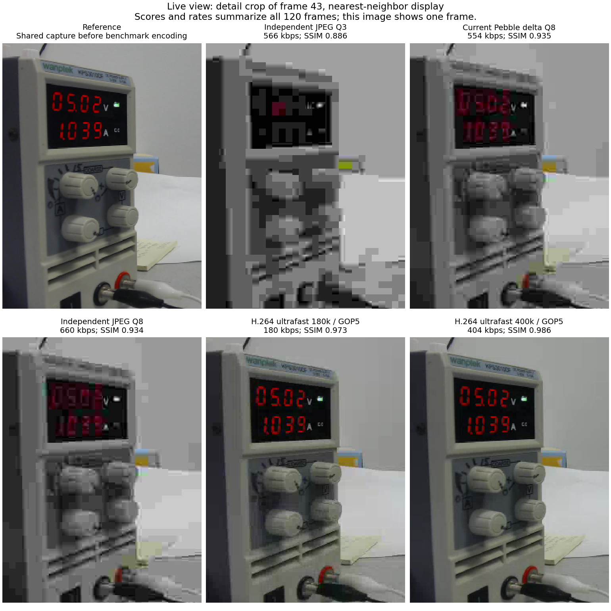
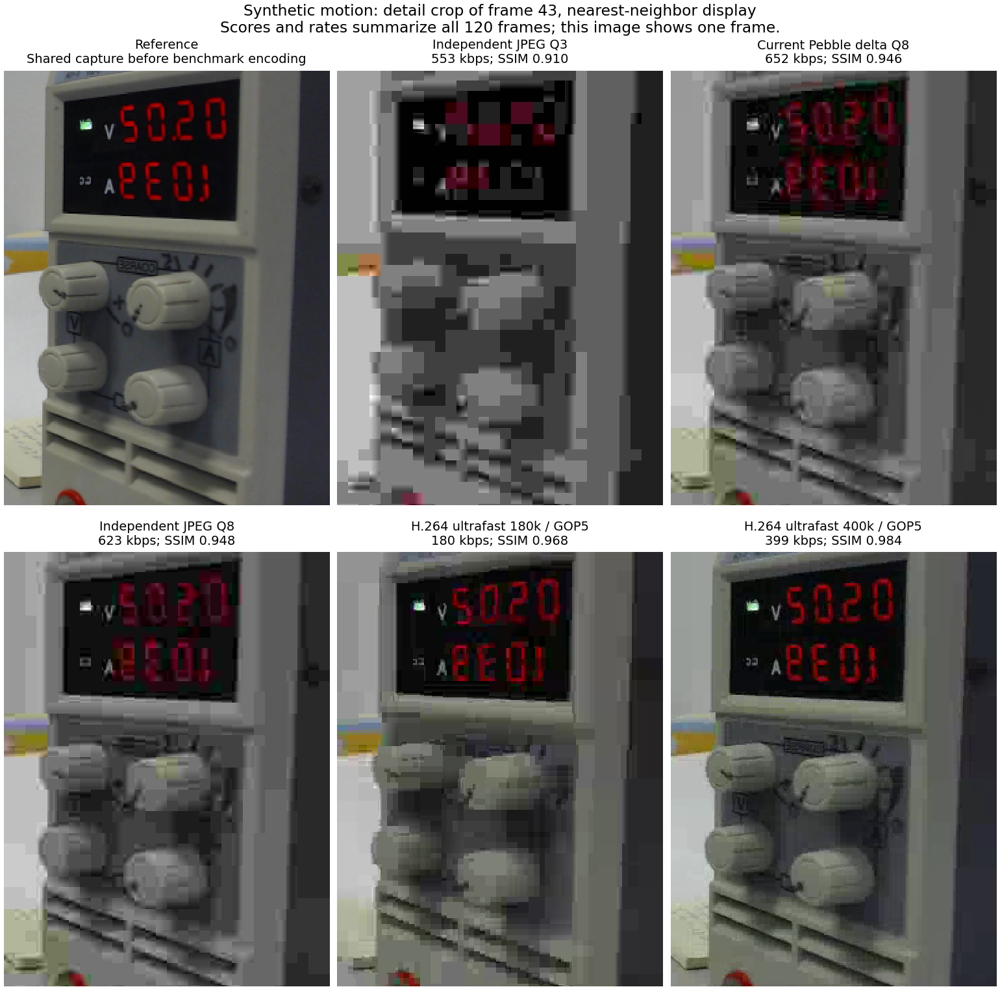
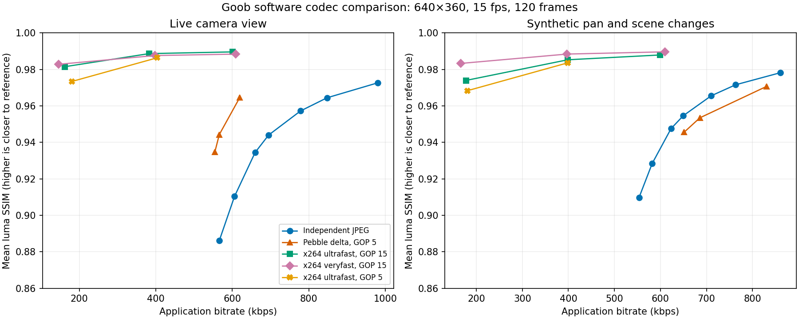
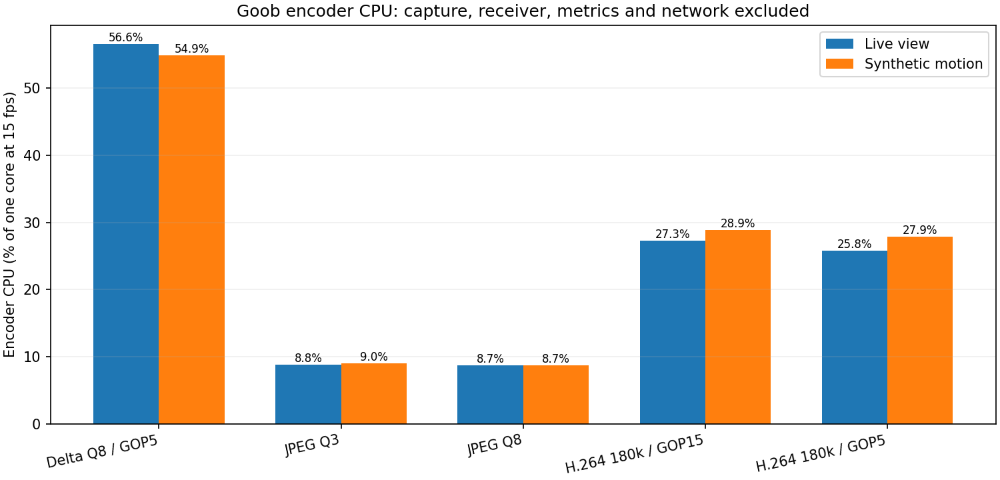

# Goob codec benchmark — October 19, 2026

Software codecs measured on Goob (Orange Pi Zero 2W / H618, Debian 12, kernel 6.1.31).
Both workloads use 120 reference frames at 640×360 and 15 fps. All codecs see the same frames within each workload.

## Main findings

- At nearly equal bitrate on this live view, the existing delta codec preserves more detail than independent JPEG quality 3.
- Independent JPEG quality 8 approximates the delta baseline's luma fidelity, but needs more bitrate on the live view. On synthetic motion its rate is slightly lower than delta.
- Software x264 ultrafast is a promising replacement: lower measured bitrate and encoding CPU than the current delta codec, with higher luma SSIM in both workloads. The five-frame GOP variants confirm the result with the same periodic recovery interval as delta.
- These samples do not establish perceptual equivalence, sustained thermal performance, or live MQTT/browser latency. Inspect the detail images and lossless reference clips.

## Selected results

CPU is percent of one CPU core at 15 fps (100% means one fully occupied core). Application bitrate includes a 19-byte envelope per frame, excludes MQTT/network overhead, and reports actual size rather than the requested x264 target.

### Live camera view

| Codec | kbps | Encoder CPU | Mean SSIM Y | p05 SSIM Y | PSNR Y |
|---|---:|---:|---:|---:|---:|
| delta-q8-g5 | 554.4 | 56.6% | 0.9348 | 0.9341 | 34.38 dB |
| jpeg-q3 | 565.9 | 8.8% | 0.8861 | 0.8853 | 28.26 dB |
| jpeg-q8 | 659.5 | 8.7% | 0.9345 | 0.9340 | 34.32 dB |
| h264-ultrafast-180k | 161.8 | 27.3% | 0.9815 | 0.9746 | 40.62 dB |
| h264-ultrafast-180k-g5 | 180.3 | 25.8% | 0.9734 | 0.9687 | 39.00 dB |
| h264-ultrafast-400k-g5 | 403.8 | 26.9% | 0.9864 | 0.9854 | 41.70 dB |

### Synthetic pan and scene changes

| Codec | kbps | Encoder CPU | Mean SSIM Y | p05 SSIM Y | PSNR Y |
|---|---:|---:|---:|---:|---:|
| delta-q8-g5 | 651.7 | 54.9% | 0.9456 | 0.9279 | 35.11 dB |
| jpeg-q3 | 553.5 | 9.0% | 0.9098 | 0.8697 | 28.50 dB |
| jpeg-q8 | 623.1 | 8.7% | 0.9476 | 0.9319 | 35.21 dB |
| h264-ultrafast-180k | 177.6 | 28.9% | 0.9740 | 0.9529 | 38.82 dB |
| h264-ultrafast-180k-g5 | 180.2 | 27.9% | 0.9683 | 0.9364 | 37.97 dB |
| h264-ultrafast-400k-g5 | 399.0 | 30.6% | 0.9836 | 0.9734 | 41.00 dB |

## Figures and artifacts

- `results.json` and `results.csv`: all codec settings and measurements.
- `live-reference.mkv`, `motion-reference.mkv`: lossless reference clips.
- `live/` and `motion/`: decoded frame 43, per-frame SSIM/PSNR logs, and encoded H.264 streams.

## Interpretation and limits

The live camera points at a bench power supply and a mostly plain wall. Whole-frame SSIM is influenced by that wall; the detail crops expose the instrument display and edges for human review. The motion clip is generated from moving crops of the captured frames and horizontal flips at frames 41 and 81. It is a repeatable stress case, not real robot motion.

SSIM and PSNR measure additional luma distortion relative to the decoded camera frames, which already contain camera MJPEG losses. They do not directly measure text legibility, AprilTag performance, color fidelity, or perception task success. Every JPEG quality number refers to OpenCV's encoder setting and is not equivalent to another codec's quality setting.

Encoding CPU excludes capture and resize. Delta includes its actual deployed sender helpers (difference calculation, JPEG encode/decode, and reference reconstruction); JPEG avoids sender reference decoding. H.264 includes process startup, BGR-to-YUV conversion and x264 encoding with two threads. OpenCV uses one thread. The run used nice 10 alongside existing robot services. Receiver measurements exclude the current web server's extra JPEG encode. Offline wall time is not live end-to-end latency.

Default H.264 profiles use baseline, zerolatency, no B-frames, a one-second GOP, and 0.5-second VBV. The `-g5` profiles match the current delta keyframe interval of five frames. Hardware H.264 encoding was not used. No robot service or MQTT topic was changed.

The paper's 181.18 kbps archived median is not a matched-condition measurement of this scene, frame rate and software revision. This experiment measures the current 15 fps configuration directly; it should not be used to infer a regression against that archive.

## Where to start

See [the first implementation milestone](../START-HERE.md). Define the minimal module/actions/endpoints contract and demonstrate shared drive controls plus a robot-local custom module. Then move AV lifecycle into the resource manager and add Opus in both directions. Prototype H.264 over MQTT with the existing software encoder and validate live latency/recovery before investigating a hardware encoder driver.

Publisher source SHA-256: `7f674f80e087f002855ea6d2ef103be00b8953a8ff71dcbc5d5e6e4bc788a0d7`.
