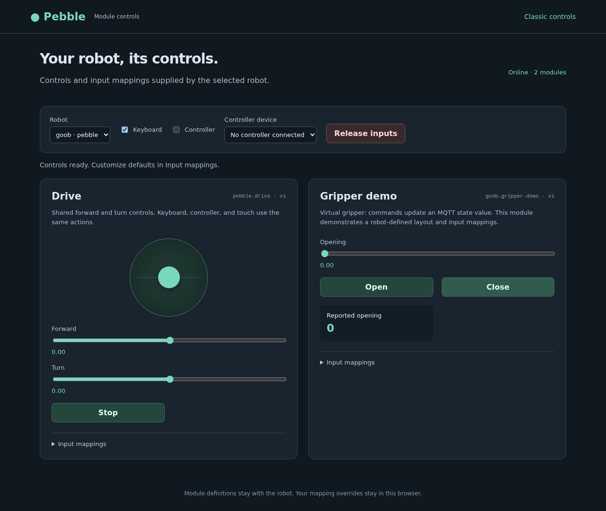

# First module milestone — October 19, 2026

Implemented locally and installed on:

- Goob: `/opt/pebble`, launched through `pebble-control.service`.
- ARL: `/home/acmattson3/Pebble`, served by the user `pebble-web-interface.service`
  on port 8080. Open the existing interface's **Module controls** button or `/modules`.
- Goob's namespace is `pebble/robots/goob`. The broker remains ARL at
  `10.10.10.163:1883`.

Verified:

- 66 focused Python unit tests, using the repository's unittest runner.
- Four Node input-engine tests.
- A Chromium test using two isolated Mosquitto brokers: discovery, custom
  controls, keyboard remapping and persistence, key handling after focusing a
  checkbox, controller axes and disconnection, pointer input, focus-loss release,
  one-way drive forwarding and retained discovery/state.
- Live Goob → ARL discovery and the virtual gripper open/close state roundtrip.
- Desktop and 390 px mobile rendering, with no JavaScript exceptions or mobile
  horizontal overflow.
- Motor commands were tested only through isolated brokers. The live check
  exercised the virtual gripper, not Goob's motors.

The new JSON Schema dependency was installed in Goob's system Python and ARL's
existing web virtual environment. ARL's configured MQTT auto-connect is enabled.
Changed runtime files/configs were backed up under each host's protected
`~/.local/state/pebble-module-backups/` directory before installation.

Source and authoring details: [module documentation](README.md).
